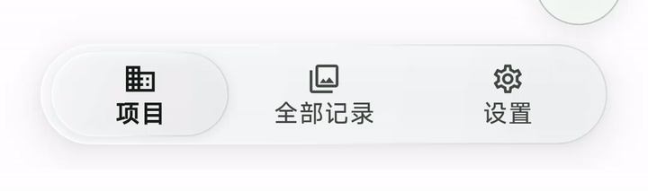
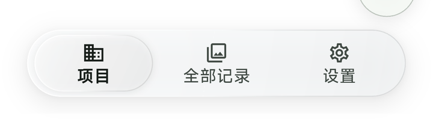
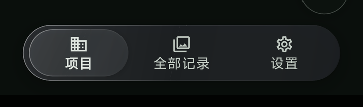

# 无色玻璃 Dock 验证

基于 `main` 的 `37503ff`，仅修改 Flutter 导航外观，不改数据库、相机、水印、相册发布、
分支生命周期和返回逻辑。与水印时间/相册导入 PR #192 独立；本批不升级版本、不发布正式安装包。

## 最终外观

- 无淡绿色或主题色指示器。外壳为中性玻璃，选中项为无色半透明透镜。
- 外壳高 64dp、最大宽 360dp；图标和文字整体居中，触控区域高 54dp。
- 指示器横向移动时拉伸、轻压并收回，高光随方向移动；快速反向切换继承当前位置和形变。
- 按压当前项轻微变形，取消后恢复。减少动画时不位移、不形变；高对比度时采用不透明中性色。
- 只有外壳一次背景模糊，透镜不增加模糊、ShaderMask 或 overlay 混合层。

下图来自本次 APK 的 Android 15 模拟器录屏，并非设计效果图。软件渲染 Debug 环境仅用于
外观和交互核对，不能据此宣称真机帧率、功耗或触感已达标。

## 验证结果

| 检查 | 本地结果 |
| --- | --- |
| CI 同款 Dart 格式检查 | 252 个文件，无改动 |
| Flutter analyze | 无问题 |
| Flutter 全量测试 | 1,228 项通过 |
| Rust fmt / Clippy | 通过，无警告 |
| Rust 测试 | 46 单元 + 48 集成通过 |
| Android x86_64 Debug APK | 构建、安装成功；含 `libsitemark_core.so` |
| Android 15 实际画面 | 中文、深浅主题、三个入口切换正常；标签和图标均在指示器内 |
| 实际窄屏检查 | 320dp 宽、系统字体 1.5 倍，文字完整、居中，无溢出 |
| 组件边界测试 | 288dp 宽、中英文、系统字体 2 倍输入、RTL、减少动画、高对比度、快速反向改选、按压取消均通过 |

组件内字体沿用有限空间的缩放上限，并在极窄英文场景缩小到可完整显示；完整语义标签和
至少 48dp 触控目标保留。对比度测试覆盖深浅主题、黑/白背景及玻璃各渐变色，文字不低于 4.5:1。
现有导航返回、保活和多选隐藏 Dock 回归测试包含在全量测试中。

本地验证 APK（仅模拟器，非手机正式包）SHA-256：
`0cb00b756a12a009f565afe1e2dae97f796f609249671e42b98a4a5e2257bd09`。

尚需：GitHub CI 独立构建，以及用户真机上的最终视觉、触感和滚动体验确认。
