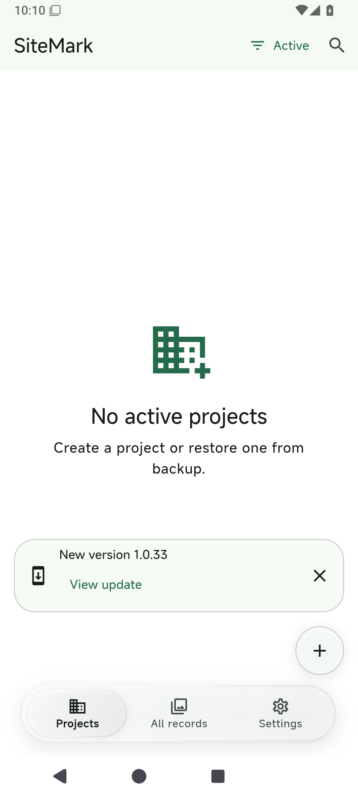
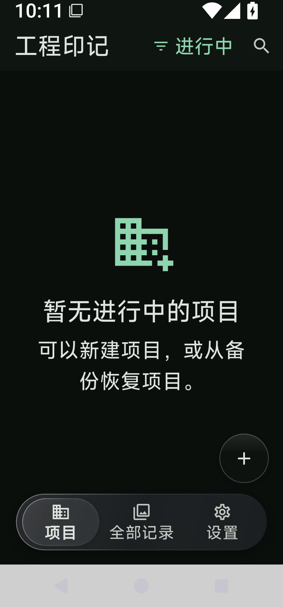

# Dock、滚动收放与自动更新验证

基线：`main@18f49aa`（v1.0.33）；本次为后续待发布改进，不改版本号、不打标签。

## 修改与回归

- 修复真实根路由切换时可选 FAB 增删导致 Dock 状态销毁；同一透镜保留位置，360ms 连续滑移。
- 横向拖动跟手，松手切到最近入口；取消、竖向拖动不误导航。覆盖 RTL、快速反向、减少动画与深浅主题。
- 隐藏/显示门槛改为 72/36dp，每次手势重新累计；顶部 64dp 内显示。惯性和程序滚动不隐藏工具栏，顶栏/Dock 共用 360ms 曲线。
- Android 自动检查仅在打开/回前台触发，每 24 小时最多一次。请求前持久化限频；关闭、读取损坏、存储失败、并发/晚回调有测试。
- 新版本用可关闭的非模态提醒；避让 Dock 和新建按钮，输入、选择或二级页面不遮挡操作。点击直接进入已有下载面板；关闭自动检查不抹掉已经显示的可下载版本。

## 自动化结果

- Flutter 3.44.6：1269 项单元/组件测试通过；`flutter analyze --no-pub` 无问题。
- 与 CI 一致的 Dart 格式检查：261 文件，0 改动；`git diff --check` 通过。
- Rust `fmt`、`clippy --all-targets -- -D warnings`、全部测试通过。
- Android x86_64 Debug APK 构建成功，安装与启动正常。无数据库、Pigeon、原生代码或权限变更。
- 手势与设置组件覆盖 320dp / 2 倍文字、中英文；Dock 原有深浅色对比度、单次模糊及减少动画回归仍通过。

## 实际模拟器检查

使用本任务独立的 Android 15 / API 35 AOSP x86_64 模拟器，未操作其他任务设备。

- 实录并逐帧查看：项目→设置→项目点击滑移、横向拖动、松手切页；项目 FAB 变化不再令指示器瞬移。
- 设置长列表：80px 小幅拖动保持顶栏/Dock；600px 有意拖动收起，160px 反向拖动恢复。
- 检查 1080×2400 / 420dpi 和 840×1800 / 420dpi（320dp）两种尺寸，后者系统字体 1.5 倍；中英文及深色 Dock 无遮挡/溢出。
- 自动更新先用当前版本验证自动得到“已是最新”；再将**本地 Debug 测试包元数据**临时设为 `1.0.32+47`，读取真实 GitHub Latest `v1.0.33`，确认提醒→关于页→“下载更新”完整可见。没有伪造 Release，也没有执行安装或发版。
- 关闭开关后杀进程重开，私有配置仍为 `enabled:false`，检查时间未变化；无崩溃日志。

本机逐帧截图、录屏与日志保存在 `D:/SiteMark-BuildCache/dock-scroll-qa/`。模拟器功能/布局验证不等同于小米等厂商真机手感或帧率验收；本次未发布 Android 正式包，也未构建/发布 iOS 或鸿蒙包。
